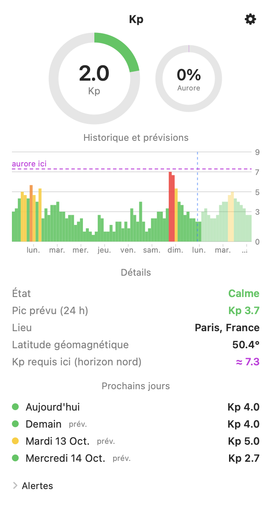
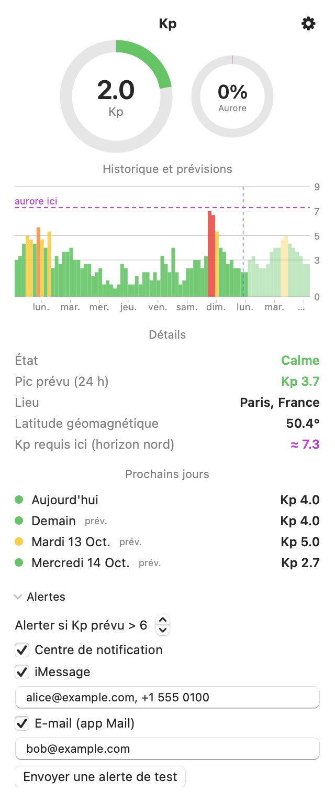

# KP Detector

[English](README.md) · **Français**

Une petite application macOS de barre de menu qui affiche l'**indice géomagnétique Kp** et ce qu'il signifie **là où vous êtes** : chances d'aurore à votre position, historique sur 7 jours et prévisions sur 3 jours.

- Titre de barre de menu `Kp 3.3`, coloré selon l'échelle NOAA (G1 – G5)
- Panneau avec jauges, courbe historique + prévisions, maxima par jour et détails locaux
- **Pertinence locale** : latitude géomagnétique, Kp requis pour voir une aurore sur l'horizon nord, probabilité d'aurore en direct (modèle OVATION de NOAA)
- **Alertes** quand le Kp prévu dépasse un seuil (par défaut : > 6) : Centre de notification, et en option iMessage et/ou Mail vers plusieurs destinataires
- Léger : ~50 Mo, 0 % de CPU au repos, pas de cache, une requête toutes les 15 minutes
- Interface en anglais et en français (selon la langue du système)

<p align="center">
  
  
</p>

## Installation

1. Téléchargez le dernier `KPDetector-x.y.z.dmg` depuis la page [Releases](../../releases).
2. Ouvrez-le et glissez **KP Detector** dans **Applications**.
3. Premier lancement : l'app n'est pas notarisée par Apple, macOS la bloque. Clic droit sur l'app → **Ouvrir**, ou *Réglages Système → Confidentialité et sécurité → Ouvrir quand même*. (Ou : `xattr -dr com.apple.quarantine /Applications/KPDetector.app`.)
4. Autorisez la localisation quand c'est demandé. Activez *Lancer à l'ouverture de session* dans le menu ⚙.

Nécessite macOS 13 ou plus récent (binaire universel : Apple silicon et Intel).

## Lire le panneau

| Zone | Signification |
|---|---|
| **Titre de la barre de menu** | Dernier Kp (valeur sur 3 h), coloré selon le niveau d'orage |
| **Anneau Kp** | Kp actuel sur 9 |
| **Anneau Aurore** | Probabilité (%) d'aurore à votre position maintenant (OVATION, NOAA). Actualisée à l'ouverture du panneau |
| **Historique et prévisions** | Une barre par 3 h : ~7 jours observés (pleines) et ~3 jours prévus (atténuées). Trait bleu pointillé = maintenant. Trait violet pointillé = Kp requis pour une aurore chez vous |
| **Détails** | Niveau d'orage, pic prévu sur 24 h, lieu, latitude géomagnétique et Kp requis localement |
| **Prochains jours** | Kp maximal d'aujourd'hui et de chaque jour prévu |

| Kp | Échelle NOAA | Couleur |
|---|---|---|
| < 5 | Calme | vert |
| 5 | G1 – mineur | jaune |
| 6 | G2 – modéré | orange |
| 7 | G3 – fort | rouge |
| 8 | G4 – sévère | rouge |
| 9 | G5 – extrême | rouge |

## Alertes

Ouvrez le panneau → **Alertes**. Choisissez un seuil, puis activez les canaux souhaités :

| Canal | Remarques |
|---|---|
| Centre de notification | Activé par défaut |
| iMessage | Numéros / Apple ID séparés par des virgules. macOS demande une fois l'autorisation de contrôler Messages |
| Mail | Adresses séparées par des virgules ; un message par destinataire. Nécessite un compte configuré dans Mail.app |

Les messages partent de votre Mac avec vos comptes. Utilisez **Envoyer une alerte de test** pour vérifier. Chaque créneau de 3 h au-dessus du seuil déclenche au plus une alerte.

## Référence des réglages

Tous les réglages sont dans le panneau : menu ⚙ et section **Alertes**. Ils sont enregistrés dans les préférences macOS (`defaults read fr.legal.kpdetector`).

| Réglage | Défaut | Description |
|---|---|---|
| Alerter si Kp prévu > N | 6 | Seuil, 3 – 9. Une alerte part pour le créneau de 3 h le plus élevé (observé ou prévu) strictement au-dessus de N |
| Centre de notification | activé | Notification locale |
| iMessage | désactivé | Destinataires : numéros ou Apple ID, séparés par virgule / point-virgule / espace |
| E-mail (app Mail) | désactivé | Destinataires : adresses, mêmes séparateurs. Un message chacun |
| Lancer à l'ouverture de session | désactivé | Menu ⚙ |
| Actualisation | 15 min | Fixe ; aussi au réveil du Mac |

Chaque créneau n'alerte qu'une fois. **Envoyer une alerte de test** vérifie l'envoi sur tous les canaux activés.

## Dépannage

- **Pas de notification** : *Réglages Système → Notifications → KPDetector* doit autoriser les alertes (et aucun mode Concentration ne doit les masquer).
- **Erreur iMessage / Mail dans le panneau** : autorisez KPDetector dans *Confidentialité et sécurité → Automatisation* (Messages, Mail). Messages doit être connecté à iMessage ; Mail doit avoir un compte.
- **Pas de position / « Kp requis ici » absent** : autorisez KPDetector dans *Confidentialité et sécurité → Service de localisation*. Le Kp fonctionne sans.
- **`Kp ?` dans la barre de menu** : NOAA est injoignable ; nouvel essai toutes les 15 min (⚙ → Actualiser).
- **Bloqué au premier lancement** : voir *Installation*, étape 3.

## Données et précision

- Kp (observé + prévu) : indice K planétaire de [NOAA SWPC](https://www.swpc.noaa.gov/). Le Kp est planétaire : identique partout.
- Probabilité d'aurore : modèle OVATION de NOAA au point de grille le plus proche.
- « Kp requis ici » est une **approximation** : frontière de l'ovale auroral ≈ 65° − 2°·Kp en latitude géomagnétique, calibrée sur des observations en France. Nuages, pollution lumineuse et horizon comptent plus que toute formule.

La position reste sur votre Mac. Seules des requêtes vers des fichiers publics NOAA sont envoyées.

## Compiler

```bash
./build.sh                  # build natif → build/KPDetector.app
./scripts/package.sh        # build universel → dist/KPDetector-<version>.dmg + .zip
```

Nécessite la chaîne Swift (Xcode ou Command Line Tools). Pour une version notarisée : `SIGN_IDENTITY="Developer ID Application: …"` et `NOTARY_PROFILE=<profil notarytool>`.

### Régénérer les captures d'écran

```bash
for l in en fr; do build/KPDetector.app/Contents/MacOS/KPDetector --screenshot docs -AppleLanguages "($l)" -AppleLocale "${l}_${l:u}"; done
```

Affiche le panneau hors écran avec des données NOAA réelles et une position d'exemple (Paris) ; vos propres réglages ne sont pas modifiés.

### Publier une version

Poussez un tag ; GitHub Actions construit le DMG/ZIP et les joint à une release :

```bash
git tag v1.0.0 && git push origin v1.0.0
```

## Licence

[MIT](LICENSE)
