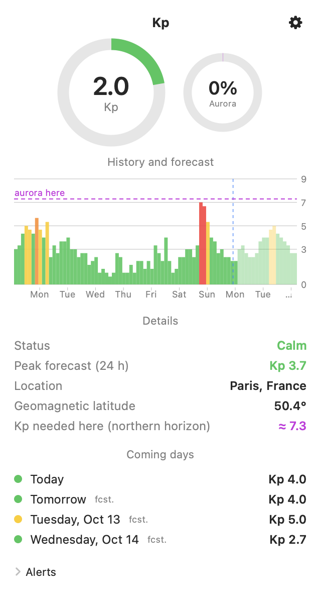
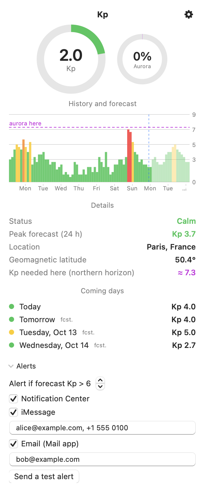

# KP Detector

**English** · [Français](README.fr.md)

A tiny macOS menu-bar app that shows the current **geomagnetic Kp index** and tells you what it means **where you are**: aurora chances at your location, a 7-day history and a 3-day forecast.

- Menu-bar title `Kp 3.3`, colored by NOAA storm scale (G1 – G5)
- Popover with gauges, history + forecast chart, daily maximums and local details
- **Local relevance**: geomagnetic latitude, Kp needed to see an aurora on your northern horizon, live aurora probability (NOAA OVATION model)
- **Alerts** when the forecast Kp exceeds a threshold (default: > 6): Notification Center, and optionally iMessage and/or Mail to several recipients
- Lightweight: ~50 MB, 0 % CPU at idle, no cache, no background polling beyond one request every 15 minutes
- English and French UI (follows your system language)

<p align="center">
  
  
</p>

## Install

1. Download the latest `KPDetector-x.y.z.dmg` from the [Releases](../../releases) page.
2. Open it and drag **KP Detector** to **Applications**.
3. First launch: the app is not notarized by Apple, so macOS will block it. Right-click the app → **Open**, or go to *System Settings → Privacy & Security → Open Anyway*. (Or run `xattr -dr com.apple.quarantine /Applications/KPDetector.app`.)
4. Allow location access when asked. Enable *Launch at login* from the ⚙ menu.

Requires macOS 13 or later (universal binary: Apple silicon and Intel).

## Reading the panel

| Area | Meaning |
|---|---|
| **Menu-bar title** | Latest Kp (3-hour value), colored by storm level |
| **Kp ring** | Current Kp out of 9 |
| **Aurora ring** | Probability (%) of aurora at your location right now (NOAA OVATION). Refreshed when you open the panel |
| **History and forecast** | One bar per 3 hours: ~7 days observed (solid) and ~3 days forecast (faded). Dashed blue line = now. Dashed purple line = Kp needed for an aurora where you are |
| **Details** | Storm level, forecast peak for the next 24 h, your location, geomagnetic latitude and the Kp needed locally |
| **Coming days** | Highest Kp for today and each forecast day |

| Kp | NOAA scale | Color |
|---|---|---|
| < 5 | Calm / unsettled | green |
| 5 | G1 – minor | yellow |
| 6 | G2 – moderate | orange |
| 7 | G3 – strong | red |
| 8 | G4 – severe | red |
| 9 | G5 – extreme | red |

## Alerts

Open the panel → **Alerts**. Choose a threshold, then enable any channel:

| Channel | Notes |
|---|---|
| Notification Center | Enabled by default |
| iMessage | Comma-separated phone numbers / Apple IDs. macOS asks once for permission to control Messages |
| Mail | Comma-separated addresses; one message per recipient. Requires a configured account in Mail.app |

Messages are sent from your Mac with your accounts. Use **Send a test alert** to check your setup. Each 3-hour slot above the threshold triggers at most one alert.

## Settings reference

Open the panel; the ⚙ menu and the **Alerts** section hold every setting. They are stored in your macOS preferences (`defaults read fr.legal.kpdetector`).

| Setting | Default | Description |
|---|---|---|
| Alert if forecast Kp > N | 6 | Threshold, 3 – 9. An alert fires for the highest 3-hour slot (observed or forecast) strictly above N |
| Notification Center | on | Local notification |
| iMessage | off | Recipients: phone numbers or Apple IDs, comma / semicolon / space separated |
| Email (Mail app) | off | Recipients: addresses, same separators. One message each |
| Launch at login | off | ⚙ menu |
| Refresh | 15 min | Fixed; also refreshes when the Mac wakes up |

Each slot alerts at most once. Use **Send a test alert** to check delivery to every enabled channel.

## Troubleshooting

- **No notification**: *System Settings → Notifications → KPDetector* must allow alerts (and not be silenced by a Focus mode).
- **iMessage / Mail error shown in the panel**: allow KPDetector under *System Settings → Privacy & Security → Automation* (Messages, Mail). Messages must be signed in to iMessage; Mail needs an account.
- **No location / "Kp needed here" missing**: allow KPDetector in *Privacy & Security → Location Services*. The Kp itself works without it.
- **`Kp ?` in the menu bar**: NOAA could not be reached; it retries every 15 minutes (use ⚙ → Refresh).
- **Blocked at first launch**: see *Install*, step 3.

## Data and accuracy

- Kp (observed + forecast): [NOAA SWPC](https://www.swpc.noaa.gov/) planetary K-index. Kp is planetary: the same everywhere.
- Aurora probability: NOAA OVATION nowcast at your grid point.
- "Kp needed here" is an **approximation**: auroral oval boundary ≈ 65° − 2°·Kp in geomagnetic latitude, calibrated on observations in France. Clouds, light pollution and your horizon matter more than any formula.

Location is used only on your Mac to compute the above. Nothing is sent anywhere except anonymous requests for public NOAA files.

## Build from source

```bash
git clone https://github.com/blegal/kp-detector && cd kp-detector
./build.sh                  # native build → build/KPDetector.app
./scripts/package.sh        # universal build → dist/KPDetector-<version>.dmg + .zip
```

Needs the Swift toolchain (Xcode or Command Line Tools). For a notarized release, set `SIGN_IDENTITY="Developer ID Application: …"` and `NOTARY_PROFILE=<notarytool keychain profile>`.

### Regenerating the screenshots

```bash
for l in en fr; do build/KPDetector.app/Contents/MacOS/KPDetector --screenshot docs -AppleLanguages "($l)" -AppleLocale "${l}_${l:u}"; done
```

Renders the panel off-screen with live NOAA data and a sample location (Paris); your own settings are not touched.

### Releasing

Push a tag; GitHub Actions builds the DMG/ZIP and attaches them to a release:

```bash
git tag v1.0.0 && git push origin v1.0.0
```

### Translating

Strings live in `Resources/<lang>.lproj/Localizable.strings` (the key is the English text). Copy `fr.lproj`, translate, and add the language to `CFBundleLocalizations` in `Resources/Info.plist`.

## License

[MIT](LICENSE)
